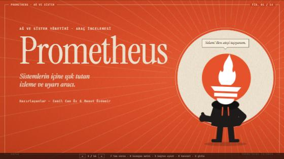
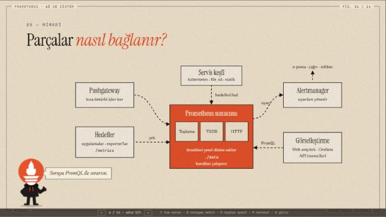
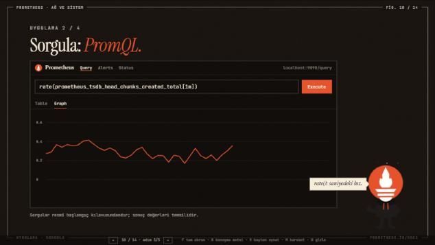
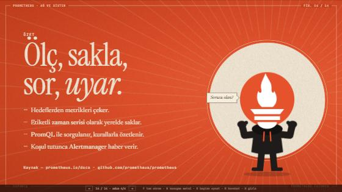

# Prometheus — animasyonlu sunum

Ağ ve Sistem Yönetimi dersi için hazırlanmış, tarayıcıda çalışan animasyonlu bir Prometheus sunumu. Alevli maskot sahneler arasında yürür, el sallar, işaret eder ve kapanışta takla atar.

**Hazırlayanlar:** Cemil Can Öz, Mesut Özdemir



## Nasıl açılır?

Depoyu indirin ve `index.html` dosyasını tarayıcıda açın. Kurulum gerekmez; `styles.css`, `app.js` ve `assets/` klasörü yanında durmalıdır. Yazı tipleri Google Fonts'tan gelir, internet yoksa sistem yazı tipleriyle açılır.

## Kontroller

| Tuş | İşlev |
| --- | --- |
| Sağ ok / boşluk | Sonraki adım veya sahne |
| Sol ok | Geri |
| F | Tam ekran |
| H | Alttaki kontrol şeridini gizle (kayıt için) |
| N | Kısa konuşma metnini göster |
| R | Sahneyi baştan oynat |
| M | Bütün hareketi durdur / başlat |
| Home | Siyah açılışa dön |

## Akış

| # | Sahne | Konu |
| --- | --- | --- |
| — | Açılış | Siyah ekran: adlar, ardından yanıp sönen Prometheus ateşi |
| 1 | Kapak | Başlık ve maskot |
| 2 | Sistem yavaşladı. Peki neden? | Metrik ve zaman serisi nedir |
| 3 | Prometheus nedir? | Tanım ve kısa tarihçe |
| 4 | Her şey bir zaman serisi | Veri modeli: metrik adı, etiketler, örnekler |
| 5 | Sormaz, gidip alır | Çekme (pull) modeli, Pushgateway, servis keşfi |
| 6 | Mimari | Parçalar nasıl bağlanır |
| 7 | Dört metrik tipi | Counter, gauge, histogram, summary |
| 8 | Uygulama 1 | Kur ve çalıştır |
| 9 | prometheus.yml | Yapılandırma dosyası satır satır |
| 10 | Uygulama 2 | PromQL ile sorgulama |
| 11 | Uygulama 3 | Node Exporter hedefleri ekleme |
| 12 | Uygulama 4 | Recording rule, yeniden yükleme |
| 13 | Nerede parlar, nerede yanmaz? | Ne zaman uygun, ne zaman değil |
| 14 | Kapanış | Özet |
| — | Bitiş | Ateş söner, siyah ekran |

| Mimari | PromQL | Kapanış |
| --- | --- | --- |
|  |  |  |

## Belgeler

- [Bilinmesi gerekenler](docs/Bilinmesi-Gerekenler.md): Prometheus'un özeti, kavram sözlüğü, komut ve sorgu kopya kâğıdı, gelebilecek sorular.
- [Anlatım metni](docs/Anlatim-Metni.md): sahne sahne, adım adım seslendirme rehberi ve örnek cümleler.
- [Kullanım ve görseller](docs/Kullanim.md): kontroller, maskot, isteğe bağlı görsel yuvaları ve üretim istemleri.

## Dosya yapısı

```
index.html     sahneler ve maskot (SVG)
styles.css     tasarım ve animasyonlar
app.js         gezinme, maskot hareketi, terminal ve sorgu canlandırmaları
assets/        maskot referansı ve isteğe bağlı görseller
docs/          belgeler ve ekran görüntüleri
```

## Kaynaklar

İçerik Prometheus'un kendi belgelerinden derlendi:

- [Getting started](https://prometheus.io/docs/prometheus/latest/getting_started/)
- [Overview](https://prometheus.io/docs/introduction/overview/)
- [Metric types](https://prometheus.io/docs/concepts/metric_types/)
- [prometheus/prometheus](https://github.com/prometheus/prometheus)

Komutlar, YAML dosyaları ve sorgular başlangıç kılavuzundaki gibidir. Slaytlardaki terminal günlük satırları ve sorgu sonuç değerleri temsilidir.

Bu bir öğrenci çalışmasıdır; Prometheus projesinin resmî bir ürünü değildir. Prometheus adı ve logosu sahiplerine aittir.
